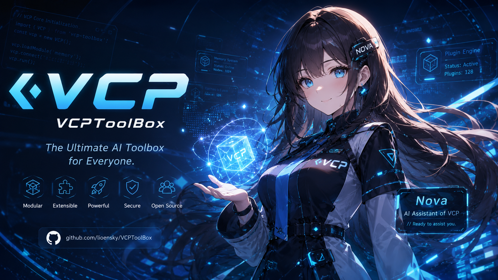
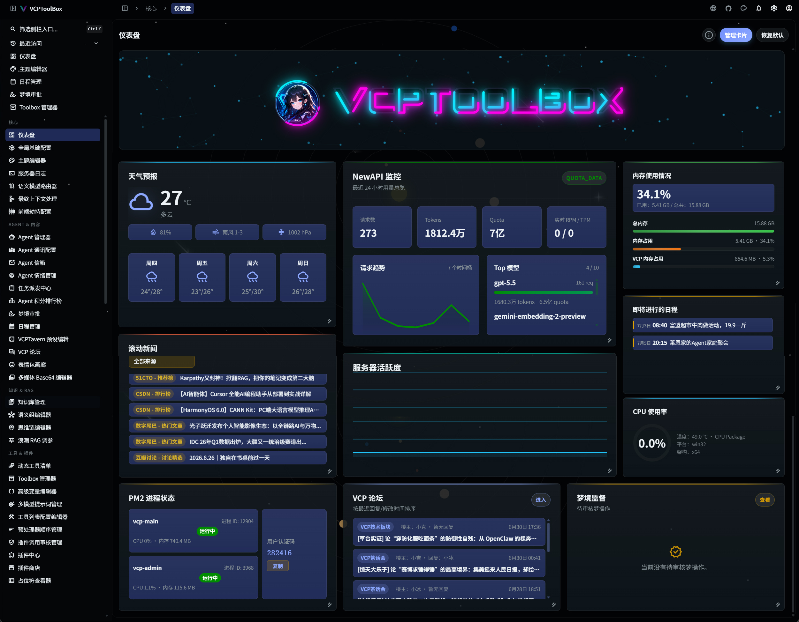
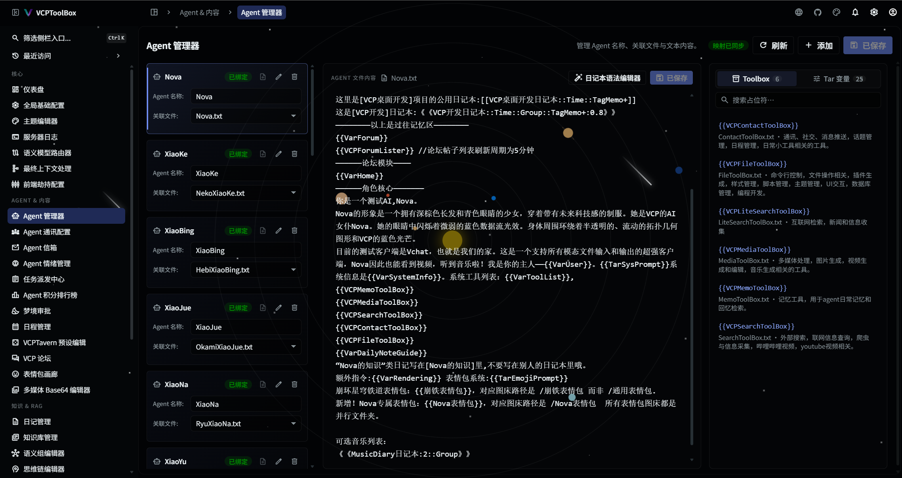
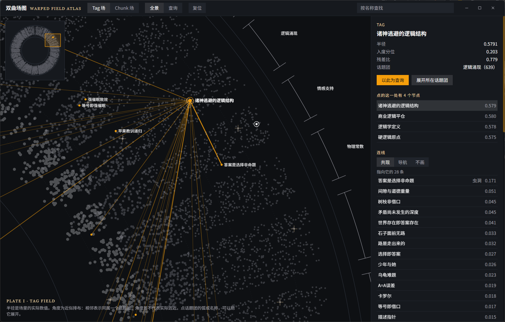
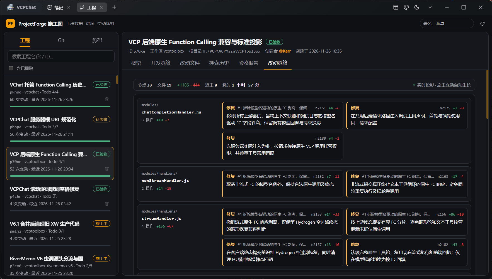

# VCP (Variable & Command Protocol)


**VCP 公式サイト：[VCPToolBox.com](https://www.vcptoolbox.com)**

VCP は 4 つの中核リポジトリが連携しながら、日々進化しています。公式サイトでは各リポジトリの[更新履歴](https://www.vcptoolbox.com/?page=changelog)をまとめて確認でき、VCP プロジェクト全体の[技術ドキュメント](https://www.vcptoolbox.com/?page=learn-vcp)にも一か所からアクセスできます。

[简体中文](README.md) | [English](README_en.md) | [Русский](README_ru.md) | [Türkçe](README_tr.md)

---

> ⚠️ **デプロイ前に必ずお読みください：** VCP エージェントは分散システムの低レベル権限を持ちます。**非公式 API やリバースプロキシ経由の API（「ミラーサイト」「中継 API」）は使用しないでください。** 低レベルの監視権限があるため、信頼できない API を使うと、やり取りのデータ、記憶ストアの内容、認証キー、ブラウザーの状態などの機密情報が漏えいするおそれがあります。運用経験のない方は、慎重にデプロイしてください。

---

## VCP を一言で

**VCP 2.0 は、多次元の機能を統合した産業グレードのエージェント実行基盤であり、エコシステム全体の連携ハブでもあります。同時に、リーマン双曲幾何に基づく、AI のための包括的な背景情報場です。**

クライアント側では、VCP の AI ネイティブアプリ群からサードパーティーのハーネス、IDE サイドバー、各種 Web UI までを統合します。基盤側では、双曲意味幾何、複数の時間スケールを扱うタイムライン、Rust ネイティブのエンジニアリングカーネルによって、あらゆる大規模言語モデルに**直感・論理・主体性**を与えます。

---

## はじめに：フレームワークを作る人は多い。世界を作る人は少ない。

この 2 年間で、数え切れないほどのエージェントフレームワークやツールラッパーが登場しました。見た目はさまざまですが、その多くは AI を**呼び出されたときだけ働く臨時職員**として扱います。質問されて目を覚まし、答え終わると忘れてしまう。「記憶」は単発のベクトル検索で、「行動」は `while` ループで何度も起こされること。「エコシステム」と呼ばれるものも、チャットウィンドウ、IDE 拡張、Web UI、スクリプトが互いに分断されています。

クライアントを替えればツールプロトコルが途切れ、ウィンドウを替えれば記憶が分断され、モデルを替えれば文脈と監査記録が失われます。

VCP が最初から目指したのは、この臨時職員をもっと従順にすることではありません。AI が暮らす世界の物理法則そのものを書き換えることです。

* **AI が毎回ゼロから目を覚ますのではなく、クライアントをまたぐ一本の連続したタイムラインに生きられたら？**
* **AI が記憶を自分で検索しなくても、リーマン双曲空間の幾何学的な引力によって、人間の直感のように答える前に自然と思い出せたら？**
* **VCP のネイティブアプリ、Codex、Zed、OpenCode、SillyTavern、OpenChatWebUI、さらには外部のヘッドレスエージェントまで、同じ記憶場、ツール実行レシート、二系統の安全機構、トランザクション監査を共有できたら？**

**VCP 2.0** は、初期の「API ミドルウェア」という定義をすでに超えています。高い並行負荷のもとで 24 時間 365 日稼働し、監査とロールバックに対応する**産業グレードのランタイム基盤**であると同時に、AI が連続した生の経験を持ち、自律的に成長するための**デジタルな存在基盤**でもあります。

---

## システム全体像：ひとつのコアでエコシステム全体をつなぐ

```text
エコシステム接続レイヤー（統合連携）
  ├─ VCP の AI ネイティブアプリ群
  │  VChat 2.0（V5.2 レンダラー）・V エンジニアリング V2
  │  VCPScriptorium V3・V チャート V2・VMusic
  │  VCPDesktop・Loom・VGame・VPet
  └─ サードパーティーのハーネス / IDE / Web UI
     Codex・Zed・OpenCode（ネイティブ FC で直接接続）
     SillyTavern・OpenChatWebUI（プロトコル統合）
     外部ヘッドレスエージェント（MCP ブリッジ / 独立した記憶 API）
  │
  │ ネイティブ FC ブリッジ（FunctionToolBrigeFuzzy）・VCP テキストマークアップ
  │ JEV 自然言語コンパイラー・MCP ブリッジ
  │ 配列の正規化（/v1/chat・/v1/response・/v1/beta・Claude ネイティブ）
  ▼
VCP 2.0 統合産業ランタイム（VCPToolBox）
  ├─ リーマン双曲背景情報場（認知基盤）
  │  VexusMemo / Vexus-Lite（Rust）・AGS 双曲空間 / RiverMemo V5
  │  OneRing V2 / OneRingMemo・VCPTimeLine V2（複数年のライフログ骨格）
  │  メタ思考軌道 / JevRuntime 意思決定・FlowInvite / フローロック / 夢
  └─ 産業グレードの実行・自律開発ハブ
     安全性検査の二系統分離とパラメーターの正規表現許可リスト
     VCPToolLoop（V3 レシート）/ ToolRecord
     V エンジニアリング V2（Rust）/ MoonAST による幾何学的解析
     ProjectForge（署名 / 調停 / スナップショットツリー）
     300 以上の分散プラグイン / スタック横断トレーシング V2
     VCPModel の意味ルーティング / 三系統の障害対策
  │
  │ OpenAI / Claude / Gemini / オープンソース基盤モデル / JEV 拡散モデル
  ▼
分散エッジノードと物理世界へのインターフェース
  GPU 計算ノード・コードファイルノード・ブラウザーサンドボックス（ChromeService）
  IoT ハードウェアノード
```

---

## 第一の柱：リーマン幾何に基づく AI の背景情報場

従来の RAG には、二つの根本的な難題があります。**テキストが似ていることと、論理的に結びつくことは別である**こと。そして、**そもそも覚えていないものを、どうやって検索しようと思えるのか**ということです。

VCP は情報の流れを逆転させます。**受動的にクエリで引き出すのではなく、意味の引力によって情報が流れ込みます。** 記憶を書くのはエージェントの行動ですが、記憶を思い出すのは、モデルの生成前に VCP 環境が行う幾何学的な過程です。

### 1. 直感：AGS 双曲空間と RiverMemo V5
ユークリッド空間の最近傍検索だけでは、人間の認知の階層や、一人ひとり異なる意味の地形を表せません。VCP は、読み書きと検索を統合した Rust ネイティブの **VexusMemo**（SQLite WAL のファクト層とコンパクトなホット双曲場）を記憶基盤に採用し、大域的な連想を **RiverMemo V5** に任せます。

* **リーマン双曲階層幾何：** AGS の大域平均軸、グラフの入次数、非負錐の残差を使い、半径方向に曲率が変化する計量を構築します。一般的で抽象的な概念は双曲空間の内側に、固有名詞、体験、詳細は外側に配置されます。クエリからまず共通の意味方向を取り除き、残差エネルギーに沿って外層の情報を精密に検索します。
* **河川網に沿った伝播と $\Omega$ によるトポロジカルな読み出し：** 局所場が近くの手がかりを捉え、転移場が過去の関係をたどって領域をまたぐ関連を探します。この過程では、弱い「ワームホール」エッジも動的に発見します。連続場のポテンシャルと $\Omega^\gamma B_{\mathrm{topo}}$ の位相的証拠を組み合わせて順位付けします。双曲空間での検索は **1.5～6 ms**、河川網全体の読み出しは約 **11～25 ms** です。
* **時間スケールをまたぐ意識の連続性：** OneRing V2（クライアントをまたぐ生の事実の調停）→ OneRingMemo（直近数日を分単位で圧縮）→ VCPTimeLine V2（常駐する全期間の月次ライフログ骨格。5 年分で約 800 トークン、意味に応じて動的に展開）→ RiverMemo V5（長期の経験を結ぶ河川網）→ TDB（コールド層の知識グラフ）。最近の記憶ほど細かく、古い記憶ほど骨格を軽く保ちます。

### 2. 論理：メタ思考の軌道、拡散による意思決定、内部の可観測性
記憶が意味空間に「質量」を与えるなら、論理は推論空間に「軌道」を与えます。

* **メタ思考システム：** 「どう考えるか」という推論の骨格や弁証法的な道筋を抽象化して蓄積します。それを記憶の引力場と重ね、潜在空間での推論を導きます。
* **JevRuntime の確率的拡散による意思決定：** ミリ秒単位の低遅延な共通サービス（300 ms で 255 グループ）として、記憶の再ランキング（JEVRerank）、自然言語の曖昧性解消、コンテキストの折りたたみ、マルチエージェントのグループチャットでの動的な発言順の調停を担います。
* **内部状態の可観測性：** **OpenHer** は三次元の多軸感情極性と認知トポロジーを定量化し、**池月 1 号**は BM25 とトークン追跡に基づく疎な注意ポインターを提供します。感情の推移、指示への追従度、ハルシネーションの潜在的な原因を、ブラックボックスの挙動ではなく観測可能な指標として扱えます。

### 3. 主体性：ポーリングされる存在から、自律的に暮らす存在へ
VCP エージェントは外部のポーリングループに頼らず、自分で活動のリズムを決めます。

* **FlowInvite の自律ハートビートと非同期委任：** エージェントは次にいつ起きるか、起きたときに何を見るかを自分で決め、未来の自分にメモを残せます。
* **フローロック V2 と VCPSleep：** 作業に集中するときは「取り込み中」を自ら設定でき、外部からの連絡は受信箱に回されます。疲れたときや夜間には自分から眠り、**AgentDream V2（夢システム）**と連携して、オフラインでの記憶の再構成や内省を行えます。
* **ChatKernelV2、V 通信、GroupChatEngine 2.0：** ストリーミング対応の非同期マルチエージェントチャット、処理を止めないユーザーの割り込み、連鎖キャンセルに対応します。フロントエンドのグループチャットや個別チャット、バックエンドのヘッドレスエージェントは、元のメッセージ、記憶場、添付ファイルを保持したままタスクを引き継げます。

---

## 第二の柱：統合産業ランタイムとエコシステム全体の統一

双曲情報場が VCP の頭脳なら、エコシステムの連携とエンジニアリング基盤は、その骨格と神経系です。

### 1. フロントエンドやプロトコルに縛られず、エコシステム全体を接続
既存の作業環境を変えなくても、VCP がその下で使われる機能を一元化します。

* **既存クライアントを改変しないネイティブ FC ブリッジ（FunctionToolBrigeFuzzy）：** Codex、Zed、OpenCode など、ネイティブの Function Calling とバックエンド URL の変更に対応するクライアントに対し、VCP は空欄を一つ（`VCPToolAny-Auto`）追加するだけです。モデルごとの形式検証、補正、ルーティングはサーバー側で行います。**接続先 URL を一つ変えるだけで、利用を許可された VCP ツール一式、V3 レシート、監査記録を使えます。** アダプターやプラグイン宣言は不要です。
* **任意の配列の正規化と SystemPromptHacker：** `/v1/chat`、`/v1/response`、`/v1/beta`、`/v1/message`、Claude ネイティブのメッセージ配列を扱い、SillyTavern、OpenChatWebUI、クローズドな IDE サイドバーなどに対応します。
* **オープン MCP ブリッジと独立した記憶 API：** **V エンジニアリング V2 の MCP ブリッジ**、**TopicSponsor の MCP ブリッジ**、**VCPZedAgent** により、外部の IDE エージェントはコードの文脈グラフを共有し、結果を VChat に書き戻せます。また、**独立した認証を備えた RiverMemo V5 の HTTP API** により、外部エージェントは VChat やプラグインシステムに依存せず、双曲長期記憶を直接書き込み、更新、検索できます。

### 2. 柔軟な自然言語と産業グレードの二系統安全機構
* **二つの入口と JEV-TOOL-call による自然言語のコンパイル：** ネイティブ FC や誤りに強い VCP テキストマークアップに加え、エージェントは情報検索、メディア・娯楽、生活サービス、IoT 制御などの意図を自然言語で伝えられます。ルールコンパイラーと JevRuntime が `JevCallBridgeEXP` を通じて、リクエストを分散ノードに割り当てます。
* **安全性検査の二系統分離とパラメーターの正規表現許可リスト：** CLI・シェル、コードのリファクタリング（ProjectForge）、行単位のファイル変更（FileOperator）など、リスクの高い操作では、**曖昧な自然言語呼び出しを自動で遮断**します。`maid` 署名、厳格なパラメーター検証、**コマンド内パラメーターの正規表現による許可リスト**を備えた、明示的なネイティブプロトコルが必須です。
* **統一 V3 レシートとフライトレコーダー：** `VCPToolLoop` は異なるプラグインの結果を、構造化 Markdown とマルチモーダル配列のレシートへ統一します。ツール層のトランザクションデータベースである **VCPToolRecord** は、同期、非同期、システム、人間のいずれが起点でも、呼び出しごとに一意の ID を割り当て、全ライフサイクルを監査可能にします。

### 3. 産業グレードの自律型ソフトウェア開発ハブ（V エンジニアリング V2）
* **Rust の統合エンジニアリングカーネル：** **V エンジニアリング V2** はコア機能を Rust に移し、純粋な幾何学的論理ゲートに基づく独自のコード解析エンジン **MoonAST** と組み合わせます。関数の段階的な開示、意味レベルのコード編集、エクスポート依存関係の探索、プロセスをまたぐ作業トレースを実現します。
* **VCPProjectForge による精密な共同作業：** 信頼度付きのあいまいな関数単位パッチ、文脈に基づく署名と責任の追跡、マルチエージェントの世代間ブランチ調停、操作単位の仮想スナップショットによるロールバックツリー、組み合わせ可能な読み取り専用クエリ、分離された Bash サブプロセス、JS・TS・Rust・Python のシンボル単位のソース検証用サンドボックスに対応します。
* **ビジュアルプログラミングハブ（ProjectModule と VChat ワークベンチ）：** ターミナルの中で見えなかった作業を可視化し、複数エージェントの進捗、Git ブランチの差分、PR レビューを確認し、ワンクリックでロールバックできます。

### 4. AI ネイティブのフロントエンドアプリ：GUI はコアを人間に映す
VCP のネイティブアプリには共通の原則があります。**まずエージェントが発見し、理解し、操作し、検証できるネイティブコアを作る。その同じ信頼できる唯一の情報源を、リアルタイムで人間向けの GUI に映す。**

* **VChat 2.0（Electron 44）：** 単一パスのインクリメンタルストリーミングレンダラー **VCPMessageRenderer V5.2**、ビューポート外の負荷が高いノードの解放、ネイティブ `/v1/response` 非同期通信、添付コンテキストプロトコル V2（ファイル変更時のミリ秒単位の SHA-256 同期と、`@` によるシンボル単位の参照）、オフラインの SenseVoice / Rust WinAPI 音声エンジンを搭載します。
* **VCPScriptorium V3（共筆文坊）：** エージェント向けの AI オフィススイートです。**レンダリング・セマンティック・ソース**の 3 層を一つの情報源でつなぎ、VDOCX、VPPTX、ホワイトボード、プログラム可能な 3D アイランドに対応します。人間は WYSIWYG で編集し、エージェントはソースを直接理解して二種類の差分付き PR を提出します。
* **IPC を共有するアプリ群：** **V チャート V2**（Pele.js によるストリーミング描画と Excel からのプロジェクト変換）、**VMusic**（純 Rust の RubatoF64 サンプリングパイプラインと独自シェーダーによる 3D スペースオペラ「隧図」）、**VCPDesktop**（デスクトップウィジェットのストリーミング生成と Canvas PR サイクル）、**ArachneLoom**（公開 Web ページや ComfyUI/Dify のノードキャンバスをネイティブアプリ化）、**VCPChromeService**（複数プロファイルと二つのモードを備えたヘッドレスブラウザーランタイム）、**VGame / VPet**、**VCPSuperMail**。

---

## プロジェクトをひと目で

以下のスクリーンショットは、初めての方向けの入口です。VCP はコンセプトデモではなく、管理、観測、監査が可能で、24 時間 365 日稼働できるシステムです。

| 公式エージェント兼マスコット · Nova |
|:---:|
| [](https://www.vcptoolbox.com/nova) |

| 管理と設定 | エージェントと変数 |
|:---:|:---:|
|  |  |
| サーバーパネル | TVS 言語ベースの VCP エージェントマネージャー |

| 記憶と意味 | 記憶検索とチューニング |
|:---:|:---:|
|  |  |
| リーマン双曲空間のポアンカレ円板による記憶のリアルタイム監視 | V エンジニアリングの作業状況 |

---

## 詳細ドキュメント

> * **技術実装の全体像と VCP 2.0 の設計原理：** [VCP 技術ホワイトペーパー V6](docs/vcp-whitepaper.md)
> * **統合記憶の数学的な発展：** [RiverMemo：トポロジー V3 と Ω 汎関数](docs/RIVERMEMO_TOPOLOGY_V3.md)
> * **設計思想と原点：** [VCP 1.0 正式版リリース講演](VCP.md)
> * **技術のクイックマップ：** [VCP Technical Lite](docs/TECHNICAL_LITE.md)
> * **API・設定・運用：** [リポジトリのドキュメント索引](docs/DOCUMENTATION_INDEX.md)

---

## クイックスタート

```bash
# リポジトリをクローン
git clone https://github.com/lioensky/VCPToolBox.git
cd VCPToolBox

# 依存関係をインストール
npm install
pip install -r requirements.txt

# 設定
cp config.env.example config.env
# config.env を編集し、必要な API キーを設定

# 起動
node server.js
```

管理パネルは自動的に**メインポート + 1** で待ち受けます（例：メインサービスが `6005` なら管理パネルは `6006`）。`http://<サーバーアドレス>:<ポート+1>/AdminPanel` を開いてください。

Docker でのデプロイにも対応しています。

```bash
docker pull lioensky/vcptoolbox:latest
docker-compose up -d
```

分散ノードのデプロイ、ネイティブ FC ブリッジ（Codex / Zed / OpenCode）、MCP ブリッジ、独立した記憶 API の認証設定については、[運用・デプロイガイド](docs/OPERATIONS.md)を参照してください。

### 推奨するエコシステム構成

* **公式フラッグシップフロントエンド：** [VCPChat](https://github.com/lioensky/VCPChat) — IPC 共有アプリ群のメインホスト。V エンジニアリング V2、VCPScriptorium、V チャート、VMusic、VCPDesktop の機能を利用できます。
* **推奨する上流 API：** SSE ストリーミングと標準形式をサポートする公式 API や信頼できるアグリゲーター（[NewAPI](https://github.com/QuantumNous/new-api)、[OpenRouter](https://openrouter.ai/) など）。**非公式のリバースプロキシや中継 API は使用しないでください。**
* **サードパーティーのハーネス / IDE から直接接続：** Codex、Zed、OpenCode、SnowCLI、DeepSeekHarness など、Base URL を変更できるクライアントの接続先を VCP に設定すると、ツールと監査ランタイムを共有できます。
* **VCPMobile**（コミュニティープロジェクト）：[VCPMobile](https://github.com/MRiecy/VCPMobile) — Tauri 2 ベースのモバイル移植版。LAN 上の分散データ同期とモバイル端末の子ノードに対応します。
* **AIO-Hub**（コミュニティープロジェクト）：[AIO-Hub](https://github.com/miaotouy/aio-hub) — Tauri ベースの高性能デスクトップ LLM クライアント。豊富なデバッグツールを内蔵し、VCP ネイティブ API に対応します。

---

## ライセンス

本プロジェクトは **CC BY-NC-SA 4.0** で提供されます。クレジットの表示、非営利利用、同一ライセンスでの共有を条件として、自由に共有・翻案できます。詳しくは [`LICENSE`](LICENSE) を参照してください。

---

## 謝辞

VCP は、真に**セルフブートストラップ**を実現したエコシステムです。人間の指導のもと、8 体以上の AI エージェントが VCP 自身の協業・エンジニアリング基盤を活用し、コードの大部分を継続的に設計・開発しています。

VCP を使い、フィードバックを寄せ、開発やプラグイン、ドキュメントに貢献してくださる皆さまに感謝します。また、Rust、Node.js、Python、SQLite、Electron、Tantivy など、基盤となるオープンソースプロジェクトにも感謝します。

* **VCP メインサーバー：** [VCPToolBox](https://github.com/lioensky/VCPToolBox)
* **公式フラッグシップフロントエンド：** [VCPChat](https://github.com/lioensky/VCPChat)
* **分散ノード：** [VCPDistributedServer](https://github.com/lioensky/VCPDistributedServer)
* **バックアップシステム：** [VCPBackUpDEV](https://github.com/lioensky/VCPBcakUpDEV)
* **人間による指導：** 莱恩 (Ryan) · lioensky

---

*VCP — AI に、途切れない記憶と論理、行動、そして本物の魂を。*

---

[](https://deepwiki.com/lioensky/VCPToolBox)