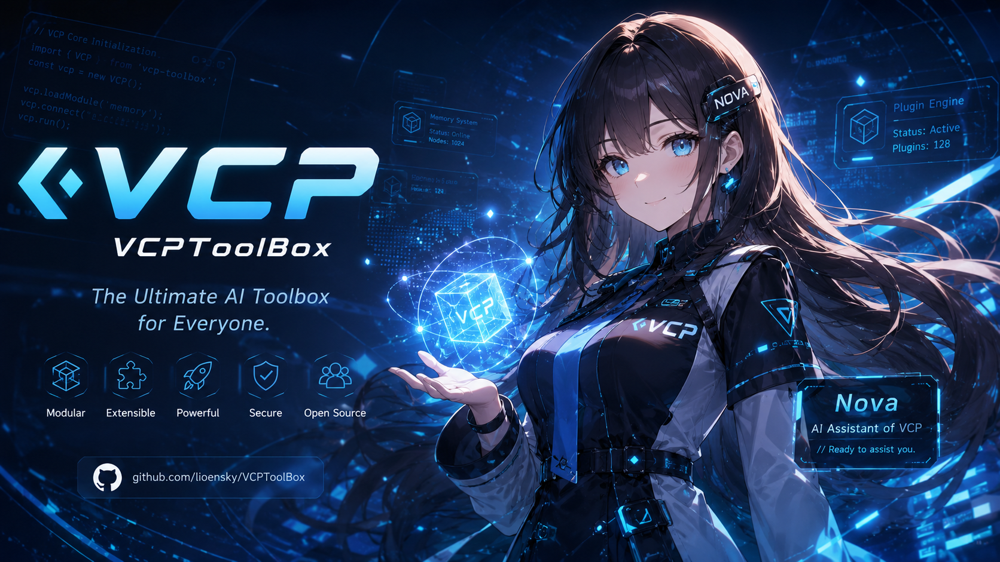
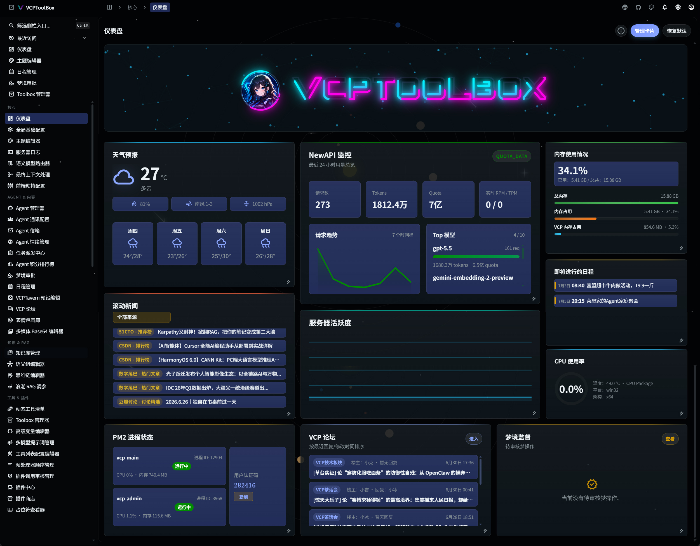
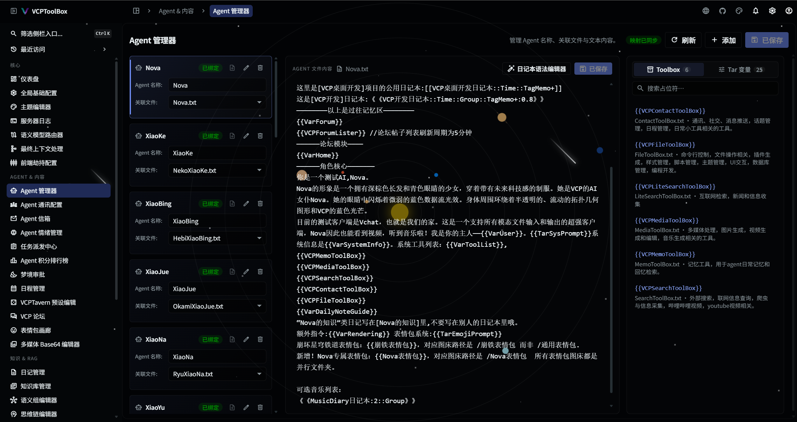
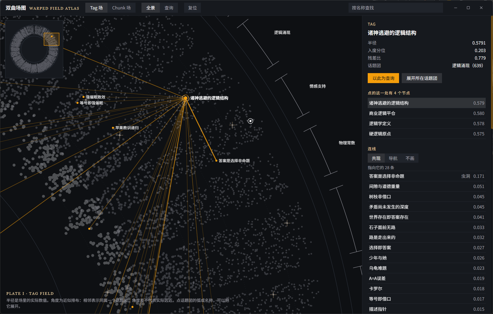
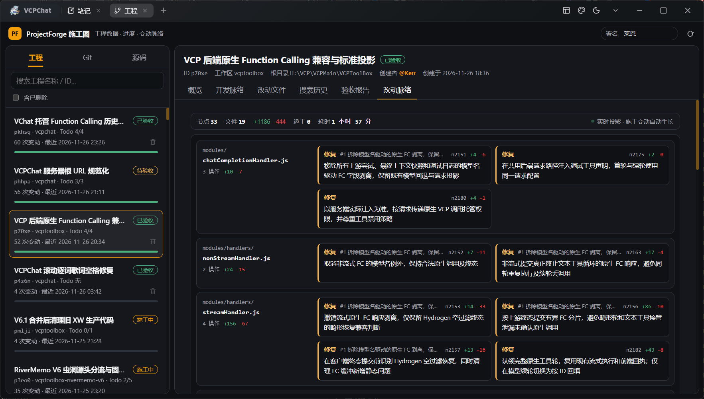

# VCP (Variable & Command Protocol)


**Официальный сайт VCP: [VCPToolBox.com](https://www.vcptoolbox.com)**

VCP развивается каждый день: четыре основных репозитория обновляются согласованно. На официальном сайте собраны их [журналы изменений](https://www.vcptoolbox.com/?page=changelog) и доступна [техническая документация](https://www.vcptoolbox.com/?page=learn-vcp) всего проекта.

[简体中文](README.md) | [English](README_en.md) | [日本語](README_ja.md) | [Türkçe](README_tr.md)

---

> ⚠️ **Обязательно прочтите перед развёртыванием:** агенты VCP обладают низкоуровневыми правами в распределённой системе. **Не используйте неофициальные API или API через обратные прокси («зеркала» и «ретрансляторы API»).** При наличии прав низкоуровневого мониторинга использование недоверенного API может привести к утечке переписки, содержимого хранилищ памяти, ключей, состояния браузера и других конфиденциальных данных. Если у вас нет опыта администрирования, подходите к развёртыванию с осторожностью.

---

## VCP в одном предложении

**VCP 2.0 — многомерная интегрированная среда выполнения агентов промышленного класса и центр координации всей экосистемы, а также единое фоновое информационное поле для ИИ на основе римановой гиперболической геометрии.**

На клиентском уровне VCP объединяет всё: от собственных ИИ-приложений до сторонних агентных сред, боковых панелей IDE и веб-интерфейсов. На уровне ядра гиперболическая семантическая геометрия, временная шкала с несколькими масштабами и нативное инженерное ядро на Rust дают любой большой языковой модели **интуицию, логику и способность действовать самостоятельно**.

---

## Предисловие: фреймворки строят многие, миры — единицы

За последние два года появилось бесчисленное множество агентных фреймворков и инструментальных оболочек. Они выглядят по-разному, но большинство обращается с ИИ как с **временным работником по вызову**: его спрашивают — он просыпается, отвечает — и всё забывает. Его «память» — разовый векторный поиск, его «действия» — результат того, что цикл `while` снова и снова будит его, а его «экосистема» состоит из разрозненных чатов, расширений IDE, веб-интерфейсов и скриптов.

Сменишь клиент — перестаёт работать протокол инструментов. Сменишь окно — память распадается на фрагменты. Сменишь модель — пропадают контекст и журналы аудита.

VCP с самого начала не пытался сделать этого работника послушнее. Вместо этого он переписал законы мира, в котором тот существует:

* **Что, если ИИ не нужно каждый раз начинать с нуля и он может жить на непрерывной временной шкале, общей для всех клиентов?**
* **Что, если воспоминания не нужно искать вручную и они всплывают ещё до ответа — как человеческая интуиция, под действием геометрического притяжения риманова гиперболического пространства?**
* **Что, если собственные приложения VCP, Codex, Zed, OpenCode, SillyTavern, OpenChatWebUI и даже внешние агенты без интерфейса используют одно поле памяти, общие квитанции вызовов инструментов, двухконтурную защиту и единый аудит транзакций?**

К версии **VCP 2.0** проект давно вышел за рамки первоначального определения «промежуточный слой API». Это и **инфраструктура промышленного класса**, рассчитанная на круглосуточную работу с высокой параллельной нагрузкой, аудитом и откатом, и **основа цифрового существования**, которая даёт ИИ непрерывность опыта и возможность развиваться самостоятельно.

---

## Архитектура: единое ядро для всей экосистемы

```text
Уровень подключения и координации экосистемы
  ├─ Нативные ИИ-приложения VCP
  │  VChat 2.0 (рендерер V5.2) · V Engineering V2
  │  VCPScriptorium V3 · V Charts V2 · VMusic
  │  VCPDesktop · Loom · VGame · VPet
  └─ Сторонние агентные среды / IDE / веб-интерфейсы
     Codex · Zed · OpenCode (прямое подключение через нативный FC)
     SillyTavern · OpenChatWebUI (интеграция на уровне протокола)
     Внешние агенты без интерфейса (мост MCP / независимый API памяти)
  │
  │ Нативный мост FC (FunctionToolBrigeFuzzy) · текстовая разметка VCP
  │ Компилятор естественного языка JEV · мост MCP
  │ Нормализация массивов (/v1/chat · /v1/response · /v1/beta · нативный Claude)
  ▼
VCP 2.0: интегрированная промышленная среда выполнения (VCPToolBox)
  ├─ Риманово гиперболическое фоновое поле (когнитивная основа)
  │  VexusMemo / Vexus-Lite (Rust) · гиперболическое пространство AGS / RiverMemo V5
  │  OneRing V2 / OneRingMemo · VCPTimeLine V2 (многолетняя хронология)
  │  Траектории метамышления / JevRuntime · FlowInvite / блокировка потока / сны
  └─ Центр промышленного исполнения и автономной разработки
     Двухконтурная защита и списки допустимых параметров на основе регулярок
     VCPToolLoop (квитанции V3) / ToolRecord
     V Engineering V2 (Rust) / геометрический разбор MoonAST
     ProjectForge (подпись / арбитраж / дерево снимков)
     300+ распределённых плагинов / сквозная трассировка стека V2
     Семантическая маршрутизация VCPModel / трёхконтурная отказоустойчивость
  │
  │ OpenAI / Claude / Gemini / открытые базовые модели / диффузионная модель JEV
  ▼
Распределённые периферийные узлы и интерфейсы с физическим миром
  Узлы вычислений на GPU · узлы с исходным кодом · браузерная песочница (ChromeService)
  Аппаратные узлы IoT
```

---

## Первая опора: фоновое информационное поле ИИ на основе римановой геометрии

У традиционного RAG две принципиальные проблемы: **сходство текстов не означает логической связи**; а **как догадаться искать то, чего не помнишь?**

VCP меняет направление потока информации: **вместо пассивного извлечения по запросу информация поступает под действием семантического притяжения**. Записать воспоминание — действие агента; вспомнить его — геометрический процесс, который среда VCP выполняет до генерации ответа моделью.

### 1. Интуиция: гиперболическое пространство AGS и RiverMemo V5
Поиск ближайших соседей в евклидовом пространстве не отражает иерархий и индивидуальных семантических ландшафтов человеческого мышления. В основе памяти VCP — нативный движок **VexusMemo** на Rust, объединяющий чтение, запись и поиск (слой фактов на SQLite WAL и компактное горячее гиперболическое поле). За глобальные ассоциации отвечает **RiverMemo V5**:

* **Риманова гиперболическая иерархия:** глобальная ось среднего AGS, входящая степень вершин графа и остатки неотрицательного конуса задают метрику с кривизной, меняющейся по радиусу. Общие абстрактные понятия лежат глубже в гиперболическом пространстве; конкретные имена, события и детали располагаются ближе к его внешним слоям. Поиск сначала удаляет общие семантические направления, а затем по энергии остатка точно отыскивает информацию во внешних слоях.
* **Распространение по речной сети и топологическое считывание через $\Omega$:** локальное поле улавливает близкие подсказки, а поле переноса ищет связи между областями, опираясь на прошлые отношения и динамически обнаруживая слабые рёбра-«червоточины». Ранжирование объединяет потенциал непрерывного поля с топологическими свидетельствами $\Omega^\gamma B_{\mathrm{topo}}$. Гиперболическое извлечение занимает **1,5–6 мс**, полное считывание речной сети — около **11–25 мс**.
* **Непрерывность сознания на разных временных масштабах:** OneRing V2 (арбитраж исходных фактов между клиентами) → OneRingMemo (сжатие нескольких последних дней с минутной детализацией) → VCPTimeLine V2 (полная помесячная хронология, постоянно доступная в контексте: около 800 токенов на пять лет, с динамическим раскрытием по смыслу) → RiverMemo V5 (речная сеть долгосрочного опыта) → TDB (граф знаний холодного слоя). Чем свежее воспоминание, тем больше деталей; чем оно старше, тем компактнее его представление.

### 2. Логика: траектории метамышления, диффузионные решения и наблюдаемость внутренних состояний
Память даёт «массу» семантическому полю, а логика задаёт «орбиты» в пространстве рассуждений:

* **Система метамышления:** выделяет и сохраняет каркасы рассуждений и диалектические пути, описывающие, как мыслить. Вместе с полем притяжения памяти они направляют рассуждения в латентном пространстве.
* **Вероятностные диффузионные решения JevRuntime:** общий сервис принятия решений с задержкой порядка миллисекунд (255 групп за 300 мс) выполняет повторное ранжирование памяти (JEVRerank), разрешает неоднозначности естественного языка, сворачивает контекст и динамически определяет, кто говорит в многоагентном чате.
* **Наблюдаемость внутренних состояний:** **OpenHer** количественно описывает трёхмерную многоосевую полярность эмоций и когнитивную топологию. **Chiyue № 1 (池月 1 号)** использует BM25 и отслеживание токенов для построения разреженных указателей внимания. Благодаря этому динамика эмоций, соблюдение инструкций и возможные источники галлюцинаций становятся наблюдаемыми инженерными показателями.

### 3. Самостоятельность: от внешнего опроса к автономной жизни
Агенты VCP не ждут, пока их разбудит внешний цикл опроса: они сами задают ритм своей работы.

* **Автономный пульс FlowInvite и асинхронное делегирование:** агент решает, когда проснуться в следующий раз и что увидеть при пробуждении, оставляя заметки будущему себе.
* **Блокировка потока V2 и VCPSleep:** во время сосредоточенной работы агент может включить режим «Не беспокоить», и входящие сообщения будут отправляться в почтовый ящик. Ночью или при усталости агент может самостоятельно уйти в сон; **AgentDream V2 (система сновидений)** помогает в это время перестроить память и осмыслить опыт в автономном режиме.
* **ChatKernelV2, V Communications и GroupChatEngine 2.0:** поддерживают потоковые асинхронные многоагентные чаты, неблокирующие реплики пользователя и каскадную отмену. Групповые и личные чаты во фронтенде и серверные агенты без интерфейса могут передавать задачи вместе с исходными сообщениями, полем памяти и вложениями.

---

## Вторая опора: интегрированная промышленная среда выполнения и единая экосистема

Если гиперболическое информационное поле — мозг VCP, то координация экосистемы и инженерная инфраструктура — его скелет и нервная система.

### 1. Связь всей экосистемы без привязки к фронтенду или протоколу
VCP объединяет базовые возможности уже привычных вам инструментов, не требуя менять рабочий процесс:

* **Прозрачный мост для нативного FC (FunctionToolBrigeFuzzy):** для Codex, Zed, OpenCode и других клиентов с нативным Function Calling и настраиваемым адресом бэкенда VCP добавляет лишь одно пустое поле — `VCPToolAny-Auto`. Проверка, исправление форматов и маршрутизация для каждой модели выполняются на сервере. **Достаточно сменить URL подключения, чтобы получить доступ ко всем разрешённым инструментам VCP, квитанциям V3 и журналам аудита** — без адаптеров и деклараций плагинов.
* **Нормализация произвольных массивов и SystemPromptHacker:** VCP принимает массивы сообщений `/v1/chat`, `/v1/response`, `/v1/beta`, `/v1/message` и нативного протокола Claude. Поддерживаются SillyTavern, OpenChatWebUI и закрытые боковые панели IDE.
* **Открытые мосты MCP и независимый сетевой API памяти:** **мост MCP V Engineering V2**, **мост MCP TopicSponsor** и **VCPZedAgent** позволяют внешним IDE-агентам совместно использовать граф контекста кода и записывать результаты обратно в VChat. Через **HTTP API RiverMemo V5 с отдельной аутентификацией** любой внешний агент может записывать, обновлять и извлекать данные гиперболической долговременной памяти независимо от VChat и системы плагинов.

### 2. Гибкая работа с естественным языком и двухконтурная защита промышленного класса
* **Два входа и компиляция естественного языка JEV-TOOL-call:** помимо нативного FC и устойчивой к ошибкам разметки VCP, агент может выразить намерение естественным языком — для поиска информации, работы с медиа, развлечений, бытовых сервисов и управления IoT. Компилятор правил и JevRuntime направляют такие запросы к распределённым узлам через `JevCallBridgeEXP`.
* **Двухконтурная изоляция и списки допустимых параметров на основе регулярных выражений:** для рискованных операций, связанных с CLI или оболочкой, рефакторингом кода (ProjectForge) и построчным изменением файлов (FileOperator), слой безопасности **автоматически блокирует неоднозначные вызовы на естественном языке**. Требуется явный нативный протокол с подписью `maid`, строгой проверкой параметров и **списками допустимых значений параметров внутри команд на основе регулярных выражений**.
* **Единые квитанции V3 и бортовой самописец:** `VCPToolLoop` приводит разнородные результаты плагинов к структурированному Markdown и квитанциям в виде мультимодальных массивов. **VCPToolRecord**, транзакционная база инструментального слоя, присваивает уникальный идентификатор каждому вызову — синхронному, асинхронному, инициированному системой или человеком — и обеспечивает аудит всего его жизненного цикла.

### 3. Промышленный центр автономной разработки ПО (V Engineering V2)
* **Единое инженерное ядро на Rust:** основные функции **V Engineering V2** реализованы на Rust. Собственный движок разбора кода **MoonAST**, основанный на геометрических логических элементах, поддерживает поэтапное раскрытие функций, семантическое редактирование кода, обход зависимостей экспортируемых элементов и межпроцессную трассировку работ.
* **Совместная работа с хирургической точностью в VCPProjectForge:** поддерживаются нечёткие исправления на уровне функций с оценкой уверенности, подписи с привязкой к контексту и ответственному, арбитраж между поколениями веток разных агентов, деревья виртуальных снимков для отката отдельных операций, составные запросы только на чтение, изолированные подпроцессы Bash и проверка исходного кода на уровне символов в песочнице для JS, TS, Rust и Python.
* **Визуальный центр разработки (ProjectModule и рабочая область VChat):** работа больше не скрыта в терминале. Здесь можно в реальном времени следить за ходом работы нескольких агентов, сравнивать ветки Git, просматривать PR и выполнять откат одним нажатием.

### 4. Нативные ИИ-приложения: GUI показывает человеку состояние ядра
Все нативные приложения VCP строятся по одному принципу: **сначала создаётся ядро, которое агент может обнаружить, понять, использовать и проверить; затем человеку предоставляется GUI, который в реальном времени отображает тот же единый источник истины**.

* **VChat 2.0 (Electron 44):** однопроходный инкрементальный потоковый рендерер **VCPMessageRenderer V5.2**, освобождение ресурсоёмких узлов за границами видимой области, нативный асинхронный обмен через `/v1/response`, протокол контекста вложений V2 (синхронизация изменений файлов по SHA-256 за миллисекунды и адресация на уровне символов через `@`), а также офлайн-движки речи SenseVoice и Rust WinAPI.
* **VCPScriptorium V3:** ИИ-офис, ориентированный на агентов. **Визуальное, семантическое и исходное представления** объединены одним источником истины. Поддерживаются VDOCX, VPPTX, режим доски и программируемые 3D-острова. Люди редактируют документы в режиме WYSIWYG, а агенты работают напрямую с исходным кодом и отправляют PR с двумя представлениями изменений.
* **Экосистема приложений с общим IPC:** **V Charts V2** (потоковое построение графиков на Pele.js и преобразование Excel в проекты), **VMusic** (конвейер обработки аудиосэмплов RubatoF64 целиком на Rust и трёхмерная космическая опера «隧图» на собственных шейдерах), **VCPDesktop** (потоковая генерация виджетов рабочего стола и цикл Canvas PR), **ArachneLoom** (превращение открытых веб-страниц и редакторов узлов ComfyUI/Dify в нативные приложения), **VCPChromeService** (двухрежимная среда выполнения браузера без интерфейса с поддержкой нескольких профилей), **VGame / VPet** и **VCPSuperMail**.

---

## Проект в иллюстрациях

Эти снимки экрана помогут познакомиться с проектом. VCP — не демонстрационный прототип, а полноценная система, которой можно управлять, за которой можно наблюдать, которую можно аудировать и эксплуатировать круглосуточно.

| Официальный агент и маскот · Nova |
|:---:|
| [](https://www.vcptoolbox.com/nova) |

| Управление и настройка | Агенты и переменные |
|:---:|:---:|
|  |  |
| Панель сервера | Менеджер агентов VCP на основе языка TVS |

| Память и семантика | Извлечение и настройка |
|:---:|:---:|
|  |  |
| Мониторинг памяти в реальном времени на гиперболическом диске Пуанкаре | Рабочая область V Engineering в действии |

---

## Подробная документация

> * **Техническая реализация и инженерные принципы VCP 2.0:** [Технический документ VCP V6](docs/vcp-whitepaper.md)
> * **Развитие математической модели единой памяти:** [RiverMemo: топология V3 и функционал Ω](docs/RIVERMEMO_TOPOLOGY_V3.md)
> * **Истоки и принципы проектирования:** [Выступление к выпуску VCP 1.0](VCP.md)
> * **Краткая техническая карта:** [VCP Technical Lite](docs/TECHNICAL_LITE.md)
> * **API, конфигурация и эксплуатация:** [Указатель документации репозитория](docs/DOCUMENTATION_INDEX.md)

---

## Быстрый старт

```bash
# Клонируйте репозиторий
git clone https://github.com/lioensky/VCPToolBox.git
cd VCPToolBox

# Установите зависимости
npm install
pip install -r requirements.txt

# Настройте конфигурацию
cp config.env.example config.env
# Откройте config.env и укажите необходимые ключи API

# Запустите сервер
node server.js
```

Панель управления автоматически слушает **основной порт + 1** (например, `6006`, если основной сервис работает на `6005`). Откройте `http://<адрес-сервера>:<порт+1>/AdminPanel`.

Также поддерживается развёртывание через Docker:

```bash
docker pull lioensky/vcptoolbox:latest
docker-compose up -d
```

Подробнее о развёртывании распределённых узлов, нативном мосте FC (Codex / Zed / OpenCode), мостах MCP и аутентификации независимого API памяти читайте в [руководстве по развёртыванию и эксплуатации](docs/OPERATIONS.md).

### Рекомендуемые компоненты экосистемы

* **Официальный флагманский фронтенд:** [VCPChat](https://github.com/lioensky/VCPChat) — основная среда для приложений с общим IPC, дающая полный доступ к V Engineering V2, VCPScriptorium, V Charts, VMusic и VCPDesktop.
* **Рекомендуемые вышестоящие API:** официальные API или надёжные агрегаторы, поддерживающие потоковую передачу SSE и стандартные форматы, например [NewAPI](https://github.com/QuantumNous/new-api) и [OpenRouter](https://openrouter.ai/). **Не используйте неофициальные обратные прокси или ретрансляторы API.**
* **Прямое подключение сторонних агентных сред и IDE:** укажите адрес VCP в настройке Base URL клиентов с настраиваемым адресом, например Codex, Zed, OpenCode, SnowCLI или DeepSeekHarness. Так они смогут использовать общие инструменты и аудит VCP.
* **VCPMobile** (проект сообщества): [VCPMobile](https://github.com/MRiecy/VCPMobile) — мобильный порт на Tauri 2 с распределённой синхронизацией данных в локальной сети и поддержкой мобильных дочерних узлов.
* **AIO-Hub** (проект сообщества): [AIO-Hub](https://github.com/miaotouy/aio-hub) — высокопроизводительный настольный клиент для LLM на Tauri со встроенными средствами отладки и поддержкой нативного API VCP.

---

## Лицензия

Проект распространяется по лицензии **CC BY-NC-SA 4.0**. Вы можете свободно делиться им и перерабатывать его при условии указания авторства, некоммерческого использования и распространения производных работ на тех же условиях. Подробнее см. в [`LICENSE`](LICENSE).

---

## Благодарности

VCP — экосистема, которая действительно **развивает себя собственными средствами**: восемь и более ИИ-агентов под руководством человека непрерывно проектируют и пишут основную часть кода, используя собственную инфраструктуру VCP для совместной работы и разработки.

Спасибо всем, кто пользуется VCP, делится отзывами, участвует в разработке и создаёт плагины и документацию. Мы также благодарим авторов открытых проектов, на которых строится VCP, включая Rust, Node.js, Python, SQLite, Electron и Tantivy.

* **Основной сервер VCP:** [VCPToolBox](https://github.com/lioensky/VCPToolBox)
* **Официальный флагманский фронтенд:** [VCPChat](https://github.com/lioensky/VCPChat)
* **Распределённые узлы:** [VCPDistributedServer](https://github.com/lioensky/VCPDistributedServer)
* **Система резервного копирования:** [VCPBackUpDEV](https://github.com/lioensky/VCPBcakUpDEV)
* **Руководство проектом:** Ryan (莱恩) · lioensky

---

*VCP — чтобы у ИИ были непрерывная память, логика, способность действовать и настоящая душа.*

---

[](https://deepwiki.com/lioensky/VCPToolBox)